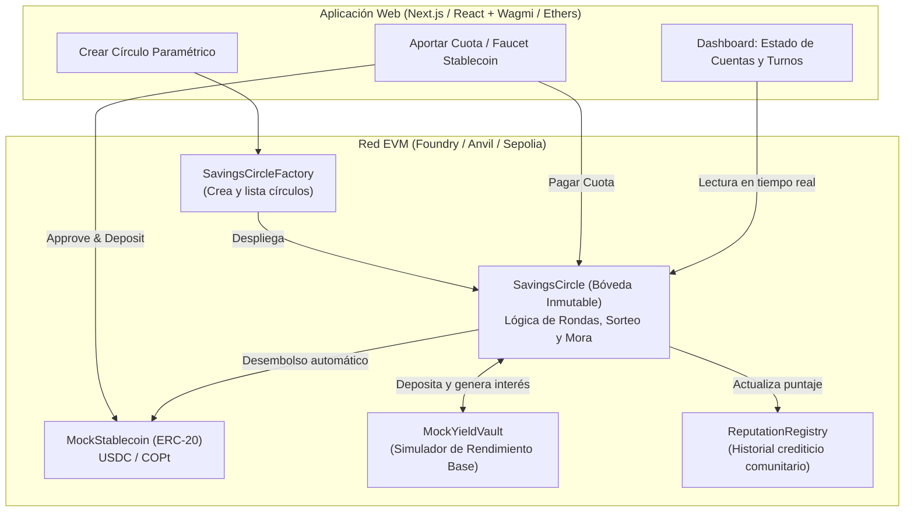
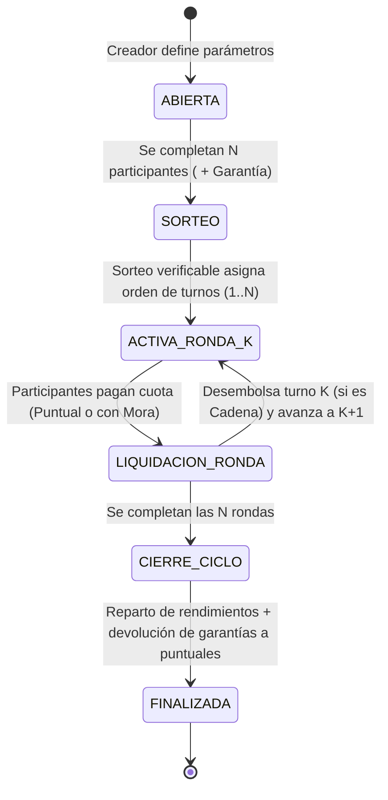

# Análisis del Proyecto #3: Círculos de Ahorro Comunitario (Blockchain)

## 1. Comprensión del Problema y Contexto
En Latinoamérica (especialmente en Colombia), existen dos variantes principales de ahorro comunitario mencionadas en el enunciado:
1. **La "Cadena" o Pasanaku (ROSCA - *Rotating Savings and Credit Association*):** Un grupo de $N$ participantes aporta una cuota fija cada periodo. En cada ronda, uno de los participantes recibe el pozo acumulado de ese periodo (adjudicado por sorteo o turno). El ciclo termina cuando todos han recibido el pozo una vez.
2. **La "Natillera" (ASCA - *Accumulating Savings and Credit Association*):** Los participantes aportan periódicamente a un fondo común que genera rendimientos durante todo el ciclo (ej. 6 o 12 meses), y al cierre del ciclo se liquida y reparte el capital más los rendimientos proporcionales (premiando la puntualidad).

### Problemas del modelo tradicional que resolvemos con Blockchain:
| Riesgo Tradicional | Solución en Smart Contract |
| :--- | :--- |
| **Riesgo de custodia / Robo / Embargo al tesorero** | **Bóveda Inmutable (Escrow descentralizado):** Los fondos residen en el contrato inteligente, sin que ningún administrador pueda retirarlos arbitrariamente. |
| **Morosidad (especialmente quien cobra primero en una cadena)** | **Garantía (Colateral) + Reglas Anti-Mora:** Depósito de garantía inicial, penalizaciones automáticas sobre rendimientos o colateral, y sistema de reputación on-chain. |
| **Falta de transparencia en turnos y cuentas** | **Sorteo Verificable y Contabilidad Pública:** Orden de turnos determinístico/verificable y trazabilidad en tiempo real de quién ha pagado y cuánto rendimiento hay acumulado. |
| **Pérdida de valor por inflación** | **Stablecoins + Yield Simulado:** Uso de un token ERC-20 estable (ej. MockUSDC / MockCOP) y un módulo generador de rendimiento base (*Mock Yield Vault*). |

---

## 2. Desglose de Requerimientos Funcionales

A partir de la sección **"Propuesta"** y **"Rol de Blockchain"**, el prototipo debe cubrir 5 pilares:

### A. Creación Paramétrica de Círculos (Patrón Factory)
El sistema debe permitir crear múltiples círculos de ahorro configurando:
- **Monto de la cuota (`contributionAmount`):** Valor en tokens estables (ERC-20) a pagar por periodo.
- **Número de participantes (`maxParticipants`):** Cupo del círculo (ej. 5 o 10 personas).
- **Periodicidad (`periodDuration`):** Duración de cada ronda (en segundos/días; parametrizable en segundos/minutos para poder hacer demos rápidas en vivo).
- **Modalidad / Reglas de adjudicación (`payoutMode`):**
  - *Modo Turnos (Cadena / ROSCA):* Desembolso en cada ronda según orden sorteado.
  - *Modo Cierre de Ciclo (Natillera):* Acumulación total y desembolso masivo al finalizar todas las rondas.
- **Depósito de garantía / Penalización por mora (`collateralAmount` / `lateFeeBps`):** Para desincentivar el impago una vez recibido el turno.

### B. Gestión de Aportes en Activos Estables (ERC-20)
- Un contrato **Token Estable de Prueba** (ej. `MockUSDC` o `cCOP` con función *faucet* para que cualquier usuario de prueba obtenga saldo).
- Registro de pagos por ronda (`round -> participant -> paidStatus`).
- Ventana de pago puntual vs. ventana de pago con recargo/mora.

### C. Reglas Anti-Mora y Reputación
Para atacar el problema clásico donde alguien recibe el primer turno de la cadena y deja de pagar:
1. **Fondo de Garantía (Security Deposit) o Retención de Rendimientos:** Al unirse, o mediante penalización por pago tardío, los usuarios puntuales acumulan **"Puntos de Puntualidad" (Shares de Rendimiento)**.
2. **Penalización Automática:** Si un participante paga tarde (mora) o incumple:
   - Pierde derecho a los rendimientos generados en el pool (o paga una multa extra).
   - Esa multa/rendimiento se redistribuye exclusivamente entre los participantes **100% puntuales**.
3. **Score de Reputación (inspirado en el paper de Berkeley de los recursos):** Un contador on-chain que registra cuántos círculos y rondas ha cumplido puntualmente una wallet, habilitándolo para círculos de mayor monto.

### D. Simulación de Rendimiento Base (Mock DeFi Yield)
- Mientras el dinero está bloqueado en la bóveda (especialmente visible en modo Natillera o sobre el colateral/pozo de cada ronda), el contrato calcula o inyecta un rendimiento base simulado (ej. un APY configurable del 5%–10% o una inyección de intereses desde un `MockYieldPool`).
- Al liquidar, los usuarios puntuales reciben: **Su Capital + Rendimiento Base + Multas de los morosos**.

### E. Sorteo Verificable y Desembolso Automático
- **Sorteo de turnos:** Generación verificable del orden de adjudicación al llenarse el cupo (usando *commit-reveal*, `prevrandao` de la EVM, o integración opcional con *Chainlink VRF*).
- **Liquidación automática:** Función ejecutable al vencer el plazo de la ronda (o al completarse los pagos de la ronda) que transfiere automáticamente el pozo al ganador del turno o reparte el fondo al cierre del ciclo.

---

## 3. Arquitectura Propuesta del Sistema

---

## 4. Ciclo de Vida del Contrato (`SavingsCircle`)

---

## 5. Diseño Detallado de Mecanismos y Reglas de Negocio

### 5.1. Parámetros de Creación de un Círculo
Cada instancia de `SavingsCircle` se configura al crearse con:
- `name`: Nombre del círculo (ej. *"Natillera Navideña Oficina"*, *"Cadena Emprendedores"*).
- `contributionAmount` ($C$): Cuota periódica en stablecoin (ej. `100 USDC`).
- `maxParticipants` ($N$): Número de miembros y total de rondas (ej. `5 participantes` $\rightarrow$ `5 rondas`).
- `roundDuration` ($T$): Duración de cada ronda (ej. `7 días`, o `60 segundos` en modo demo).
- `gracePeriod` ($G$): Ventana para pagar puntualmente sin recargo dentro de la ronda.
- `collateralAmount` ($D$): Depósito de garantía inicial reembolsable al final del ciclo (protección anti-fuga).
- `latePenaltyBps` ($P$): Porcentaje de multa por pago extemporáneo (ej. `500 bps` = $5\%$ sobre la cuota).
- `yieldRateBps` ($Y$): Tasa de rendimiento base simulado por ronda (ej. `100 bps` = $1\%$ por ronda sobre el saldo bloqueado).
- `payoutMode`:
  - `0 = ROSCA (Por Turnos / Cadena)`: Al cerrarse cada ronda $k$, el participante con el turno $k$ recibe automáticamente el pozo de cuotas de esa ronda ($N \times C$).
  - `1 = ASCA (Al Cierre del Ciclo / Natillera)`: Las cuotas de todas las rondas permanecen bloqueadas en el `MockYieldVault` generando interés compuesto hasta finalizar la ronda $N$.

### 5.2. Reglas Anti-Mora y Distribución de Rendimientos a Puntuales
El enunciado exige: *"Aplicación de penalizaciones y distribución de rendimientos a puntuales"*.
1. **Pago Puntual ($t \le \text{inicioRonda} + G$):**
   - El participante paga exactamente $C$.
   - Gana **1 Punto de Puntualidad (`onTimeShares`)** en esa ronda y suma `+10 puntos` en su reputación global.
2. **Pago en Mora ($\text{inicioRonda} + G < t \le \text{finRonda}$):**
   - El participante paga $C + \text{Multa}$ donde $\text{Multa} = C \times P / 10000$.
   - La multa entra directamente al **Bolso de Rendimientos (`rewardPool`)**.
   - **No gana** Punto de Puntualidad en esa ronda (pierde participación en los rendimientos de ese periodo).
3. **Incumplimiento Total (Default al cierre de la ronda):**
   - Si un participante no paga antes de liquidar la ronda, el contrato **cubre su cuota automáticamente descontándola de su Garantía (`collateral`)** más la multa correspondiente, para que el participante que recibe el turno no se vea afectado.
   - Su reputación on-chain sufre una penalización severa.
4. **Fórmula de Reparto de Rendimientos al Cierre del Ciclo:**
   El pozo de premios ($\text{RewardPool} = \text{Rendimiento Base Generado} + \sum \text{Multas de Morosos}$) se distribuye proporcionalmente a los puntos de puntualidad:
   $$\text{Premio}_i = \text{RewardPool} \times \frac{\text{onTimeShares}_i}{\sum_{j=1}^{N} \text{onTimeShares}_j}$$

### 5.3. Sorteo Verificable (Transparencia Algorítmica)
- Cuando se inscribe el participante número $N$, el contrato ejecuta el algoritmo de barajado **Fisher-Yates on-chain** alimentado por una semilla criptográfica verificable (`keccak256(abi.encodePacked(block.prevrandao, block.timestamp, participantsHash, creatorSeed))`) y emite el evento auditable `TurnsAssigned(address[] orderedParticipants, bytes32 seedUsed)`.
- Cualquier usuario puede verificar en la interfaz la semilla exacta y el orden de adjudicación de los turnos $1 \dots N$.

### 5.4. Reputación Crediticia Comunitaria (*Good Reputation - Berkeley*)
Siguiendo la referencia académica del proyecto, un contrato `ReputationRegistry` lleva el historial inmutable de cada dirección:
- Rondas pagadas a tiempo vs. pagos tardíos vs. defaults.
- Círculos completados exitosamente.
- Cálculo de un **Credit Score Comunitario (0 a 1000)** que se muestra en el dashboard de cada miembro.

---

## 6. Stack Tecnológico y Estructura del Proyecto

1. **Smart Contracts (`foundry/`):**
   - `src/MockStablecoin.sol`: Token ERC-20 (`cUSD` / `cCOP`) con Faucet libre para pruebas.
   - `src/MockYieldVault.sol`: Bóveda que custodia los fondos bloqueados y simula el rendimiento base sobre el saldo.
   - `src/ReputationRegistry.sol`: Registro de reputación crediticia descentralizada.
   - `src/SavingsCircle.sol`: Contrato principal de la bóveda inmutable (Cadena y Natillera).
   - `src/SavingsCircleFactory.sol`: Fábrica para crear y consultar círculos paramétricos.
   - `test/SavingsCircle.t.sol`: Suite de pruebas unitarias e integrales en Foundry (flujo feliz, pagos en mora, absorción por garantía, sorteo verificable, ambos modos de desembolso).
2. **Frontend Web3 (`web/`):**
   - **Next.js + Tailwind CSS + Viem/Wagmi** (más un selector rápido de cuentas de prueba de Anvil / modo simulación interactivo para poder cambiar entre los $N$ participantes con un clic durante la demostración sin tener que cambiar manualmente en MetaMask 5 veces).
   - **Panel de Control en Vivo:** Creación de círculo, tabla de turnos sorteados, estado de cuenta por ronda, simulador de paso de tiempo (*Avanzar a ventana de mora / Avanzar ronda*) y desglose de rendimientos + multas.

