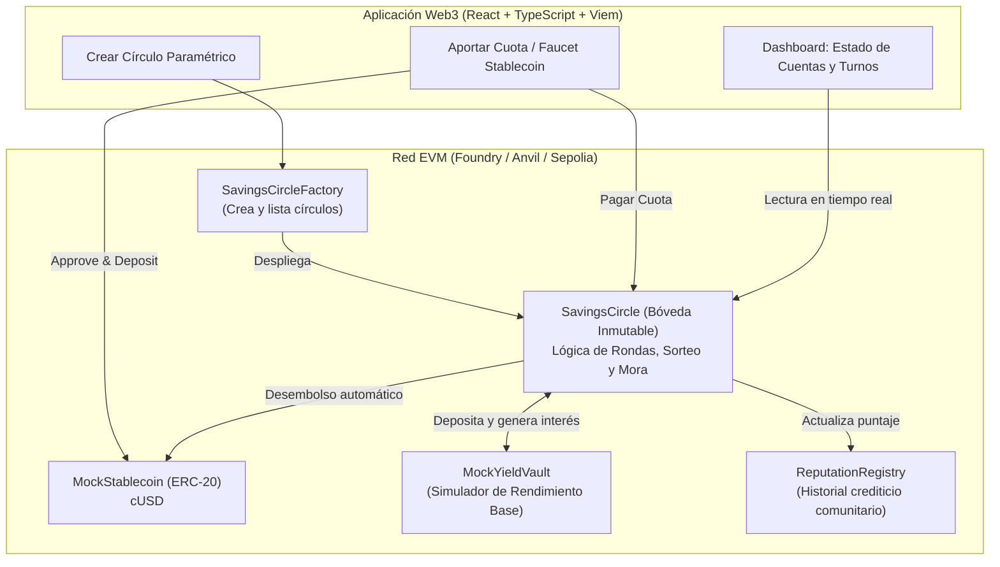
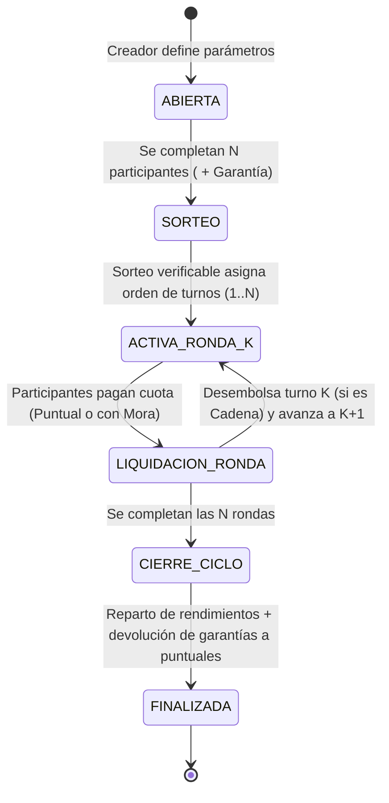

# Análisis del Proyecto #3: Círculos de Ahorro Comunitario (Blockchain)

## 1. Comprensión del Problema y Contexto
En Latinoamérica (especialmente en Colombia), existen dos variantes principales de ahorro comunitario mencionadas en el enunciado:
1. **La "Cadena" o Pasanaku (ROSCA - *Rotating Savings and Credit Association*):** Un grupo de $N$ participantes aporta una cuota fija cada periodo. En cada ronda, uno de los participantes recibe el pozo acumulado de ese periodo (adjudicado por sorteo o turno). El ciclo termina cuando todos han recibido el pozo una vez.
2. **La "Natillera" (ASCA - *Accumulating Savings and Credit Association*):** Los participantes aportan periódicamente a un fondo común que genera rendimientos durante todo el ciclo (ej. 6 o 12 meses), y al cierre del ciclo se liquida y reparte el capital más los rendimientos proporcionales (premiando la puntualidad).

### Problemas del modelo tradicional que resolvemos con Blockchain:
| Riesgo Tradicional | Solución en Smart Contract |
| :--- | :--- |
| **Riesgo de custodia / Robo / Embargo al tesorero** | **Bóveda Inmutable (Escrow descentralizado):** Los fondos residen en el contrato inteligente, sin que ningún administrador pueda retirarlos arbitrariamente. |
| **Morosidad (especialmente quien cobra primero en una cadena)** | **Garantía (Colateral) + Reglas Anti-Mora:** Depósito de garantía inicial, penalizaciones automáticas sobre rendimientos o colateral, y sistema de reputación on-chain. |
| **Falta de transparencia en turnos y cuentas** | **Sorteo Verificable y Contabilidad Pública:** Orden de turnos determinístico/verificable y trazabilidad en tiempo real de quién ha pagado y cuánto rendimiento hay acumulado. |
| **Pérdida de valor por inflación** | **Stablecoins + Yield Simulado:** Uso de un token ERC-20 estable (`cUSD`) y un módulo generador de rendimiento base (`MockYieldVault`). |

---

## 2. Arquitectura del Sistema

---

## 3. Ciclo de Vida del Contrato (`SavingsCircle`)

